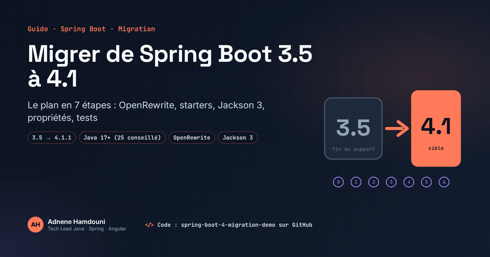
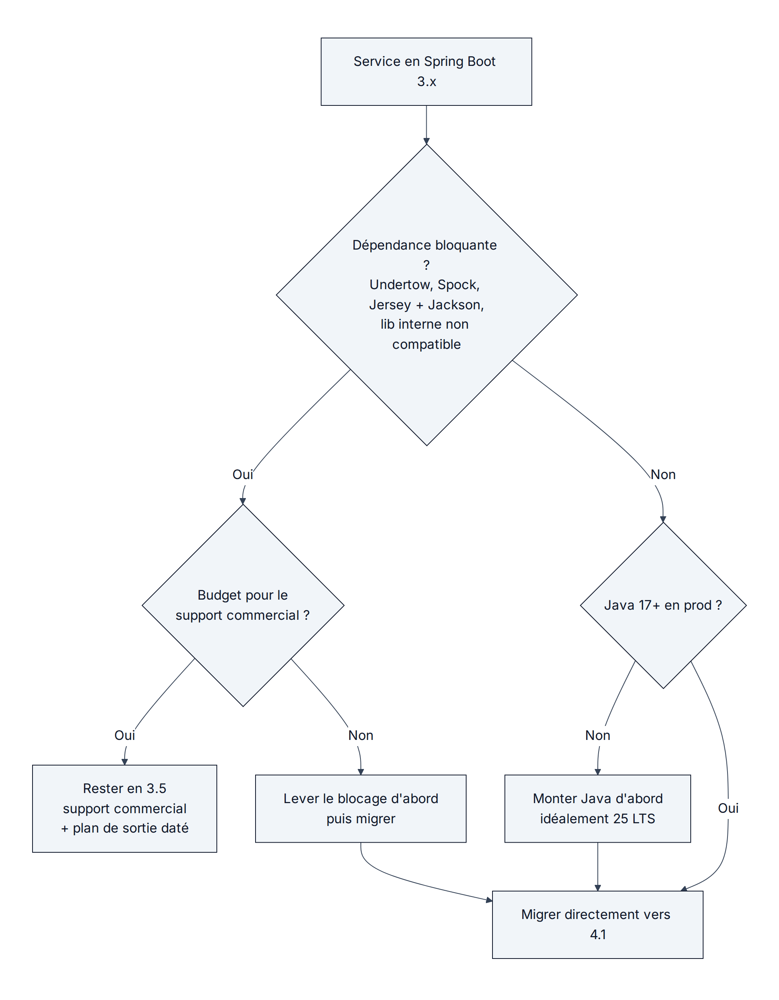
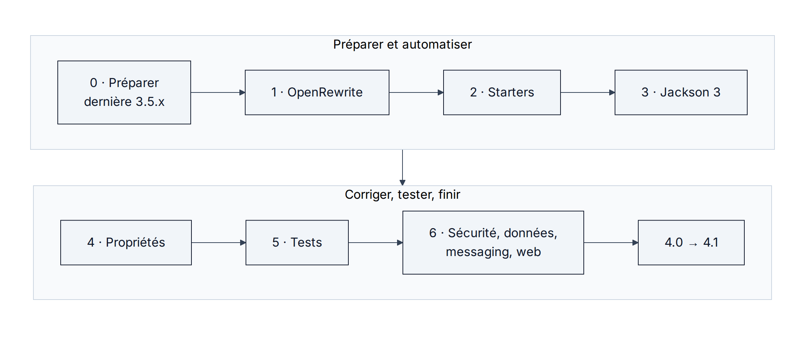

# spring-boot-4-migration-demo



Le même petit service (`catalog-api` : REST + JDBC + Flyway + H2) en **Spring Boot 3.5** (`before/`)
et en **Spring Boot 4.1.1** (`after/`), pour lire la migration commit par commit.

Code d'accompagnement de l'article « Migrer de Spring Boot 3.5 à 4.1 : le guide complet ».

> **Statut : non vérifié.** Ce dépôt a été écrit à partir du guide de migration officiel 4.0 et des
> release notes 4.1. Tant que `mvn verify` n'a pas tourné sur les deux dossiers (localement ou dans la CI),
> considérez-le comme un exemple pédagogique, pas comme une référence exécutée.

## Ce que la migration change ici

| Étape de l'article | `before/` (3.5) | `after/` (4.1) |
|---|---|---|
| 2. Starters | `spring-boot-starter-web` | `spring-boot-starter-webmvc` |
| 2. Flyway | `flyway-core` seul | `spring-boot-starter-flyway` |
| 4. Propriétés | – | profil Maven `migration` avec `spring-boot-properties-migrator` |
| 5. Tests | `@MockBean` | `@MockitoBean` |
| 5. Slice MVC | `org.springframework.boot.test.autoconfigure.web.servlet.WebMvcTest` | `org.springframework.boot.webmvc.test.autoconfigure.WebMvcTest` + `spring-boot-starter-webmvc-test` |
| Java | 21 | 25 |

Le détail, fichier par fichier, est dans [MIGRATION.md](MIGRATION.md). Pour voir le diff brut :

```bash
diff -ru before after
```

## Lancer

```bash
cd before && mvn verify        # Java 21+
cd ../after && mvn verify      # Java 25+
mvn spring-boot:run            # http://localhost:8081/api/products
```

## Les deux tests qui servent de filet

- `ProductControllerContractTest` fige le JSON (`releasedOn` en `2025-01-15`, champs attendus) : c'est lui qui
  doit attraper un changement silencieux de sérialisation lors du passage à Jackson 3.
- `FlywayMigrationTest` échoue si l'auto-configuration Flyway disparaît. Pour le vérifier, retirez
  `spring-boot-starter-flyway` de `after/pom.xml`, remettez `flyway-core`, et relancez `mvn verify`.

## Schémas



*Source : [docs/diagrams/decision-tree.mmd](docs/diagrams/decision-tree.mmd)*



*Source : [docs/diagrams/roadmap.mmd](docs/diagrams/roadmap.mmd)*

## Licence

MIT
